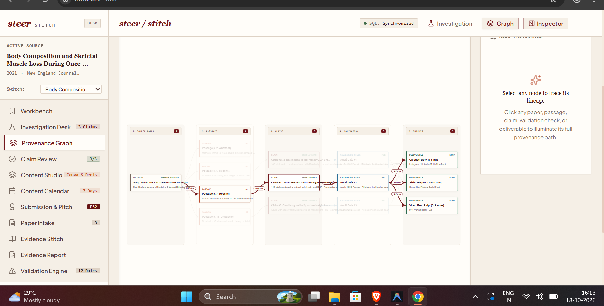

in claim review , the reject or flag issue must reomve the corresponding claim from the ui and resume with the content generation 
based on feasability is it possbiel to generate multiple content if multiple claims are present with varying data 
content calendar is not upated accordingly 
theres 2 stages of input , after the pdf ingestion and then the claims . what is the use of investigation report after claim review? not sure double check 
the ui of provenance graph must be updated use this as reference 

